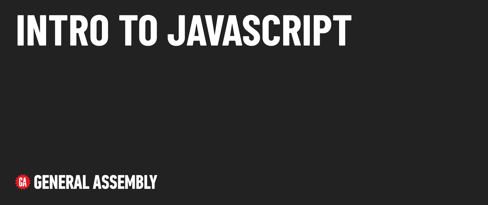

# Intro to JavaScript

## Module overview

This module introduces basic concepts in JavaScript.

## Content outline

| Lesson | Video Time | Video | Topics Covered |
| ------ |:----------:|:-----:| -------------- |
| [Setup](./setup/README.md)                               | --- | --- | ---                                                                                                                   |
| [Concepts](./concepts/README.md)                         | --- | --- | Define JavaScript and explain its purpose.                                                                            |
| [Fundamentals](./fundamentals/README.md)                 | --- | --- | Learn the basics of JavaScript programming, including code comments, code execution, and console output.              |
| [Variables](./variables/README.md)                       | --- | --- | Understand the basics of JavaScript variables, including naming conventions and the difference between let and const. |
| [Primitive Data Types](./primitive-data-types/README.md) | --- | --- | Declare and use primitive data types in JavaScript.                                                                   |
| [Template Literals](./template-literals/README.md)       | --- | --- | Use template literals to combine strings in JavaScript.                                                               |
| [Reference Data Types](./reference-data-types/README.md) | --- | --- | Create and use objects in JavaScript.                                                                                 |
|  **Total Module**                                        | --- | --- | ---                                                                                                                   |

## Additional content 

📖 [Reference Materials](./references/README.md)

### 🚀 Level Up

- [History of JavaScript](./level-up/history-of-js.md)
- [Dynamic vs. Static Typed Languages](./level-up/dynamic-vs-static-typed-languages.md)
- [Weak vs. Strong Typed Languages](./level-up/weak-vs-strong-typed-languages.md)
- [Primitive vs. Reference Types](./level-up/primitive-vs-reference-types.md)
- [Implicit and Explicit Type Conversion](./level-up/implicit-and-explicit-type-conversion.md)

## Internal resources

✏️ [Instructor Guide](./internal-resources/instructor-guide.md)

🎥 [Video Hub](./internal-resources/video-guide/README.md)

🏗️ [Release Notes](./internal-resources/release-notes.md)

---

**Find a 👾 bug 👾 or have suggestions? [Let us know](https://git.generalassemb.ly/modular-curriculum-all-courses/universal-resources-internal/blob/main/module-feedback.md)!**
