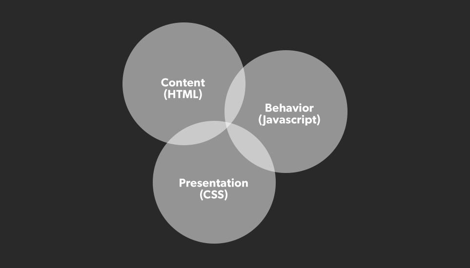

# Intro to JavaScript - Concepts

## What is JavaScript?

JavaScript is a powerful and versatile programming language that can be used to create interactive web pages, as well as server, mobile, and desktop applications. It is a high-level language, which means that it is relatively easy to learn and use, even for beginners.

JavaScript, along with **HTML** and **CSS**, is one of the three essential technologies used to create web pages. HTML defines the structure of a web page, CSS styles the page, and JavaScript adds interactivity.

The primary responsibility of JavaScript is to allow developers to implement behavior in web applications via a client-side script that runs in the browser.

The following graph shows the top languages on GitHub over time.

JavaScript is the only programming language that can be used directly in web browsers, so it has become increasingly popular as web-based applications have become more common.

## Why use JavaScript?

There are a lot of reasons that we use JavaScript, including:

  - **It's a versatile language**. JavaScript can be used for many different purposes, such as adding interactivity to web pages, commmunicating with web servers, and creating games and other applications. 

  - **It's easy to learn**. As a high-level language, JavaScript is relatively easy to read and write. 

  - **It's the most popular language for web development**. JavaScript is used by millions of developers around the world to create dynamic and interactive web pages and applications. 

  -  **It's lightweight**. This means it doesn't require a lot of resources to run. 

  - **It's constantly evolving**. New improvements and features are constantly being added to JavaScript. 

  - **It's supported by all major web browsers**. This allows JavaScript applications to be accessible to a wide audience. 

Here are some specific examples of how JavaScript is used:

  - **Add interactivity to web pages**. We can use JS to create dynamic animations and effects, validate user input, and add interactive elements to web pages like forms, menus, and buttons. You see JavaScript every day in:
    - The search bar on Amazon or Google 
    - The embedded video in a news article
    - The refreshing of your X feed 

  - **Create interactive applications and games**. JS allows us to create engaging and complex applications without needing to download software. These popular apps were built with JavaScript:
    - The browser game Angry Birds
    - Google
    - Slack web client
  
  - **Building *server-side* applications**. The framework **Node.js** (which we'll discuss more another time), is used to build scalable and efficient web applications like:
    - Uber
    - Netflix
    - PayPal

> 📚 *Server-side* refers to anything that happens on the remote server, like the code that interacts with databases and processes user requests. 
>
> Javascript is also used to write *client-side* code, which refers to anything that happens on the user's device. Any code or resources that are downloaded to the user's browser and executed there are client-side. This code is responsible for what the user sees and interacts with on the page, like the event that occurs when you click a button on a webpage. 

