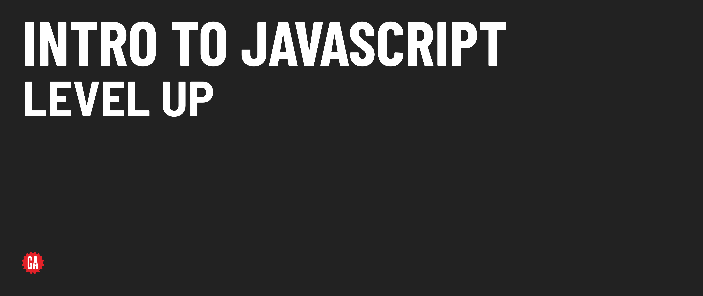

# Intro to JavaScript - Level Up - Dynamic vs. Static Typed Languages



*Dynamically-typed* languages such as JavaScript, Python, and Ruby allow variables to be assigned different types of data during runtime (as the program executes). 

For example, in JavaScript we can do this:

```js
// Declare variable named data and initialize with a number
let data = 123
// Reassigning a different type of data is allowed
data = 'Hello'
```

However, *statically-typed* languages such as Java and C++ required a variable's type to be declared and cannot be changed:

```js
// Declare a variable as an integer and initialize
int data = 123
// Assigning anything other than an integer raises an error
data = "Hello" // NOT ALLOWED
```

> 📚 In a *dynamically-typed* language, the type of a variable can change at any time and are assigned a type based on whatever the variable’s value is at the time. In a statically-typed language, once a variable is given a type, that type cannot change.